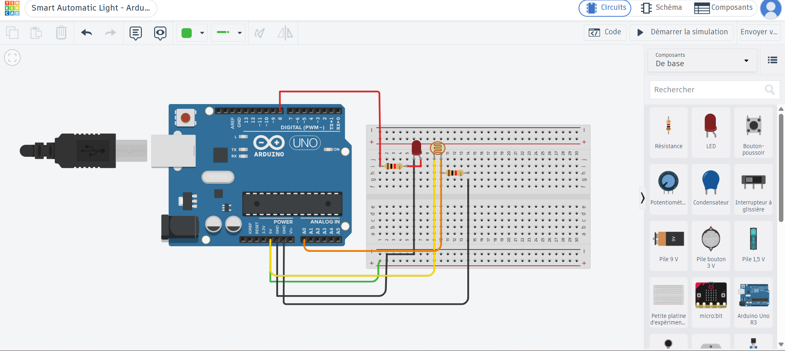

# Smart Automatic Light Using Arduino

## Project Description
This project simulates an automatic lighting system using an Arduino Uno and an LDR (Light Dependent Resistor). The LED is controlled according to the detected light level.

## Components
- Arduino Uno
- LDR sensor
- LED
- Resistors
- Breadboard
- Jumper wires

## How It Works
- If the light level is below 300, the LED turns ON.
- If the light level is between 300 and 599, the LED remains OFF.
- If the light level is 600 or higher, the LED remains OFF.

## Technologies
- Arduino programming (C/C++)
- Tinkercad Circuits

## What I Learned
- Reading sensor values using analog input.
- Controlling an LED using digital output.
- Using conditional statements (`if`, `else if`, `else`).
- Testing an embedded system through simulation.

## Simulation
The circuit was designed and tested using Tinkercad Circuits.
## Project Screenshots

### Tinkercad Circuit

### Code and Simulation

